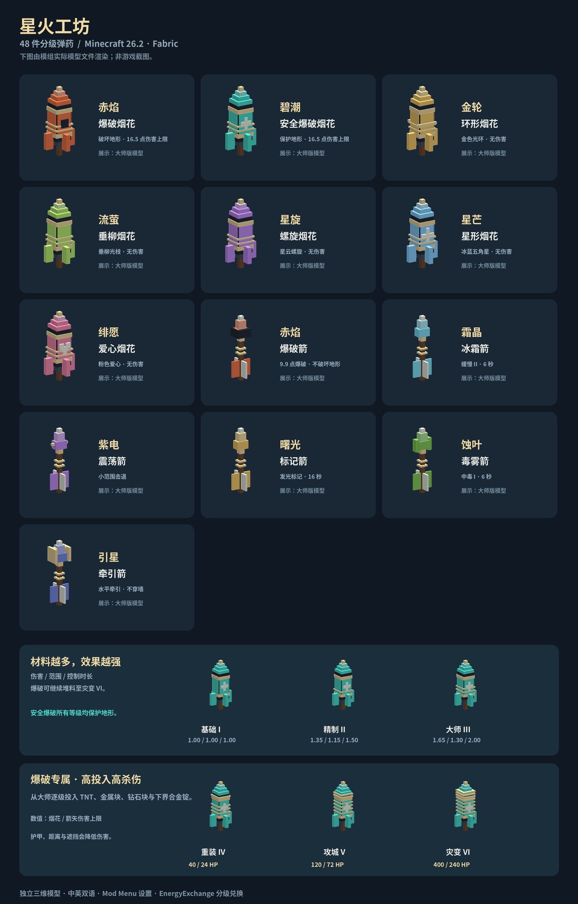

# 星火工坊 · Starfall Workshop

下载 [0.1.0-pre3 模组安装包](downloads/starfall-mc26.2-0.1.0-pre3.jar)。

Minecraft Java Edition 26.2 / Fabric — **0.1.0-pre3 试玩版**。

包含 7 种烟花和 6 种箭矢，共 48 件独立物品。全部物品提供基础、精制、大师三级；爆破烟花、安全爆破烟花和爆破箭可继续升级为重装、攻城、灾变，使用大量高价材料换取大幅提高的杀伤与范围。星形烟花、爱心烟花、毒雾箭和牵引箭也包含在内。不同等级使用独立注册 ID，EnergyExchange 兑换不会把大师弹药变回基础弹药。



## 安装

1. 使用 **Minecraft 26.2、Java 25、Fabric Loader 0.19.3 或更高版本**。
2. 安装适用于 26.2 的 **Fabric API 0.159.0+26.2 或更高兼容版**。
3. 将 `starfall-mc26.2-0.1.0-pre3.jar` 放入 `mods`，替换旧版本，不要同时保留两版。多人服务器和所有客户端均需安装。
4. 可选：**Mod Menu 20.0.2**，在模组列表点击配置按钮；不需要 Cloth Config。
5. 可选：**YKZStudio/EnergyExchange 0.3.5 的 26.2 版**，已进行实际共同加载、48 项价格读取测试。

只安装运行 JAR；源码 ZIP 和 smoke-tests 测试 JAR 不应放入正常游玩存档。

依赖下载：
- [Fabric](https://fabricmc.net/use/installer/)
- [Fabric API](https://modrinth.com/mod/fabric-api/versions?g=26.2)
- [Mod Menu](https://modrinth.com/mod/modmenu/versions?g=26.2)
- [EnergyExchange 0.3.5](https://github.com/YKZStudio/EnergyExchange/releases/tag/v0.3.5)

## 内容与基础数值

以下为默认配置下、基础等级的数值。2 点伤害 = 1 颗心；护甲、爆炸遮挡等会降低实际伤害。

| 物品 | 作用 | 基础材料 → 产量 |
|---|---|---|
| 赤焰·爆破烟花 | 爆炸强度 2；伤害上限 10；可破坏地形 | 烟花火箭×1、火药×2、铁锭×1 → 1 |
| 碧潮·安全爆破烟花 | 同样有爆炸伤害；始终保留地形 | 烟花火箭×1、火药×2、铁锭×1、黏液球×1 → 1 |
| 金轮·环形烟花 | 金色光环，无伤害 | 烟花火箭×1、荧石粉×1、金粒×1 → 1 |
| 流萤·垂柳烟花 | 垂柳形光枝，无伤害 | 烟花火箭×1、荧石粉×1、黏液球×1 → 1 |
| 星旋·螺旋烟花 | 紫色螺旋图案，无伤害 | 烟花火箭×1、紫水晶碎片×1、红石粉×1 → 1 |
| 星芒·星形烟花 | 冰蓝五角星图案，无伤害 | 烟花火箭×1、荧石粉×1、紫水晶碎片×1 → 1 |
| 绯愿·爱心烟花 | 粉色爱心图案，无伤害 | 烟花火箭×1、红石粉×1、黏液球×1 → 1 |
| 赤焰·爆破箭 | 爆炸强度 1.2；伤害上限 6；不破坏地形 | 箭×4、火药×1、铁锭×1 → 4 |
| 霜晶·冰霜箭 | 直击 4 点；2.5 格范围缓慢 II，3 秒 | 箭×4、雪球×2、紫水晶碎片×1 → 4 |
| 紫电·震荡箭 | 直击 4 点；3 格范围击退 | 箭×4、黏液球×1、紫水晶碎片×1、红石粉×1 → 4 |
| 曙光·标记箭 | 直击 4 点；2.5 格范围发光，8 秒 | 箭×4、荧石粉×1 → 4 |
| 蚀叶·毒雾箭 | 直击 4 点；2.5 格范围中毒 I，3 秒 | 箭×4、蜘蛛眼×1、黏液球×1 → 4 |
| 引星·牵引箭 | 直击 4 点；3 格范围水平牵引至落点，距离越远力度越小 | 箭×4、末影珍珠×1、紫水晶碎片×1 → 4 |

以上均为无序工作台配方，拿到相应材料后解锁配方书。新物品也列在创造模式战斗分类里。

“安全爆破”保护地形，不代表免除自身或友方的爆炸伤害。玩家伤害与爆炸击退遵守服务端 PvP（玩家对战）开关和队伍友伤规则。

## 堆料升级

采用逐级固定配方投入材料。所有物品提供前三档，后三档仅限爆破烟花、安全爆破烟花和爆破箭：

| 等级 | 伤害倍率 | 范围／图案尺寸倍率 | 控制时长倍率 | 额外材料 |
|---|---:|---:|---:|---|
| 基础 I | 1.00 | 1.00 | 1.00 | 上表基础配方 |
| 精制 II | 1.35 | 1.15 | 1.50 | 上一级成品 + 火药×2 + 铜锭×2 |
| 大师 III | 1.65 | 1.30 | 2.00 | 上一级成品 + 火药×2 + 紫水晶碎片×2 + 金粒×1 |
| 重装 IV（爆破专属） | 4.00 | 1.80 | — | 大师成品 + TNT×2 + 铁块×2 + 钻石×1 |
| 攻城 V（爆破专属） | 12.00 | 2.70 | — | 重装成品 + TNT×2 + 钻石块×2 + 金块×1 |
| 灾变 VI（爆破专属） | 40.00 | 4.00 | — | 攻城成品 + TNT×2 + 下界合金锭×2 + 钻石块×1 |

烟花每次升级 **1 个 → 1 个**；箭矢每次升级 **4 支 → 4 支**。升级不会改变弹药种类。模型随等级增加金属环，高阶爆破另加弹头装甲箍。

示例：大师安全爆破烟花默认伤害上限 **16.5 点**；大师爆破箭上限 **9.9 点**；大师冰霜箭缓慢持续 **6 秒**；大师标记箭发光持续 **16 秒**。所有等级的安全爆破和爆破箭始终不破坏地形。

爆破高阶默认数值如下，伤害为护甲减免前的单个目标上限；2 点 = 1 颗心。爆炸强度的两倍约为实体影响半径，实际伤害随距离、遮挡、护甲与抗性降低。

| 等级 | 烟花伤害上限 | 爆破箭伤害上限 | 烟花／爆破箭爆炸强度 | 烟花／爆破箭实体影响半径 |
|---|---:|---:|---|---|
| 大师 III | 16.5 | 9.9 | 2.6／1.56 | 5.2／3.12 格 |
| 重装 IV | 40 | 24 | 3.6／2.16 | 7.2／4.32 格 |
| 攻城 V | 120 | 72 | 5.4／3.24 | 10.8／6.48 格 |
| 灾变 VI | **400** | **240** | 8／4.8 | 16／9.6 格 |

从大师堆到灾变，烟花每件额外投入 TNT×6、铁块×2、钻石×1、钻石块×3、金块×1、下界合金锭×2；箭矢是每 4 支投入同样材料，所有升级均保留产量，不能跳级。`damageScale=2` 时灾变上限为烟花 **800 点**、箭矢 **480 点**；默认仍为 1。高阶伤害提升参与实际结算，完整实体方块遮挡不会放大原版的最低擦伤。安全烟花和爆破箭在所有六级都不破坏地形，普通爆破烟花遵守地形开关。

毒雾箭的中毒时长为 **3／4.5／6 秒**，始终为中毒 I，遵守原版中毒免疫与非致死规则；直击伤害仍可致死。牵引箭的范围为 **3／3.45／3.9 格**，仅施加一次水平拉力，不传送、不额外抬升目标，也不破坏地形。星形和爱心图案随等级放大，所有等级均无伤害。

## 使用与平衡

- 烟花可在方块上使用，也可装入弩或由发射器发射；弩发射速度、耐久消耗沿用原版烟花标准。
- 战斗烟花不提供鞘翅加速，避免加速后在身上爆炸。观赏烟花可加速且无伤害。
- 箭矢可由弓、弩或发射器发射；飞行时使用对应的立体弹头与尾羽模型。
- 特殊箭矢命中后消耗，不可回收，不享受无限附魔的免耗弹药效果。
- 多重射击保留原版一次装填的消耗规则；爆炸仍受实体受伤间隔影响。
- 特殊箭的伤害由等级和配置确定；不叠加原版力量、暴击、穿透或火矢的额外效果。这些弹药侧重消耗材料换取范围与控制。
- 冰霜、震荡、标记、毒雾、牵引范围效果检查视线，不穿过实体方块生效；命中方块也会触发范围效果。观赏烟花移除了原版烟花伤害。
- 爆炸使用原版爆炸伤害来源、护甲结算和遮挡计算；不生成火焰。

## 设置

Mod Menu → 星火工坊 → 配置。单人游戏可保存后立即生效；主菜单可保存本地预设。连接多人服务器时，界面只显示不可编辑的本地预设，不代表远端服务器的实际配置。

专用服务器管理员修改 `config/starfall.json` 后重启：

```json
{
  "terrainDamage": true,
  "damageScale": 1.0,
  "explosionPower": 2.0,
  "particleBudget": 96
}
```

- `terrainDamage`：只控制普通爆破烟花是否破坏地形；安全弹药不受它影响。
- `damageScale`：伤害倍率，允许 0～2。
- `explosionPower`：基础烟花爆炸强度，允许 1～3，再乘等级范围倍率。
- `particleBudget`：观赏图案基础粒子数，允许 24～144；等级和额外闪光会影响实际粒子总数。战斗效果使用较低密度。
- 配置损坏时使用禁止地形破坏的后备配置，并保留损坏文件供排查。

## EnergyExchange 联动

通过它官方支持的逐物品数据规则接入，未安装 EnergyExchange 时这些资源不会产生硬依赖。

路径：`data/starfall/energyexchange/values/<物品ID>.json`，如：

```json
{ "value": "708" }
```

购买与转化同价，按已验证的原版材料价值和配方产量向下取整。完整价格见 [数值表](docs/balance.json)。管理员可用高优先级数据包覆盖对应文件并执行 `/reload`；用 `/ee value` 检查手持物品。

等级是物品身份的一部分，兑换保留等级；EnergyExchange 自身仍会丢弃重命名等附加数据。若整合包修改材料价格或合成产量，需要同步调整本模组价格。

## 开发、验证与已知限制

安装完整 JDK 25 后：

```sh
./gradlew build
```

Windows：`gradlew.bat build`。重新生成资源需要 Python 3、Pillow：`python tools/generate_grades.py`；检查资源：`python tools/validate_assets.py`。预览图脚本另需 NumPy 和自备中文字体。

本版使用 JDK 25、Gradle 9.6.0 和 Loom 1.17.12 构建主端、客户端及独立服务器测试模组。428 项服务器断言、5 项纯逻辑测试和 48 套资源／配方／价格校验通过。服务器行为与联动测试结果见 [验证记录](docs/VALIDATION_zh-CN.md)。运行 JAR 不包含游戏或依赖库。

复跑服务器测试：先在 `build/smoke-server` 配置仅供测试的服务器并接受 Minecraft EULA，再运行 `./gradlew -PstarfallSmoke runSmokeServer`。测试入口默认关闭，只对该显式参数启用；测试会修改测试世界并在结束后关闭服务器。可将 EnergyExchange 26.2 版放入该目录的 `mods`，额外验证全部价格。不要对正常游玩存档运行测试。

**尚未在图形客户端实机验收**：客户端代码已编译，模型文件已渲染检查，但 Mod Menu 界面、在游戏中的朝向与光照、多人客户端视觉效果仍需实际游玩确认。因此版本保留试玩标记 `pre3`。预览图是从模型 JSON 渲染的示意，不是游戏截图。
